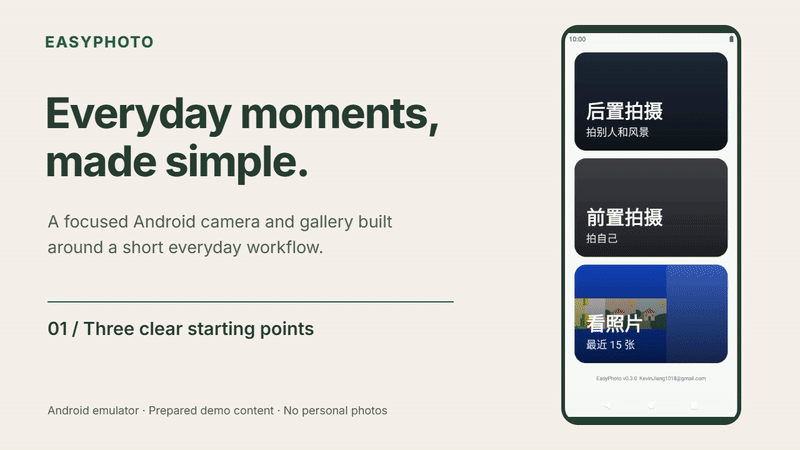
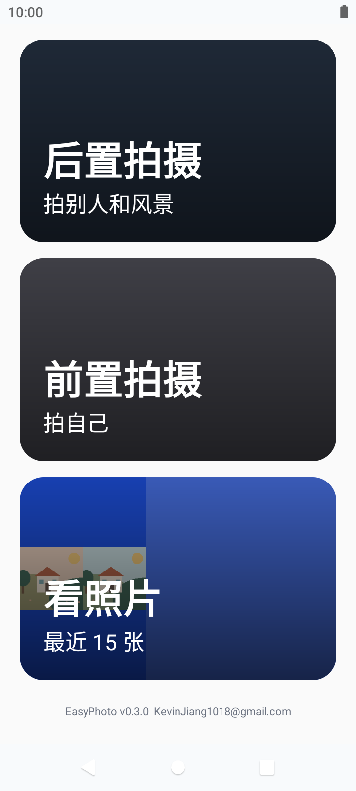
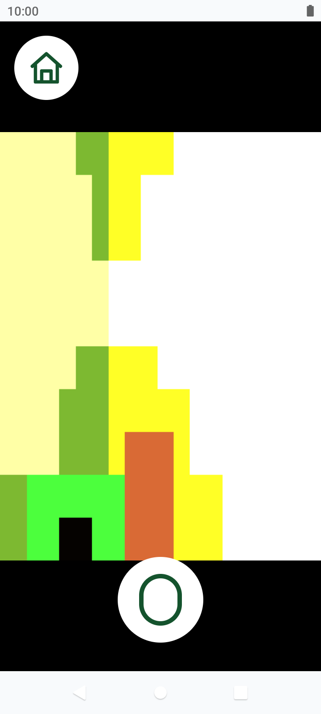
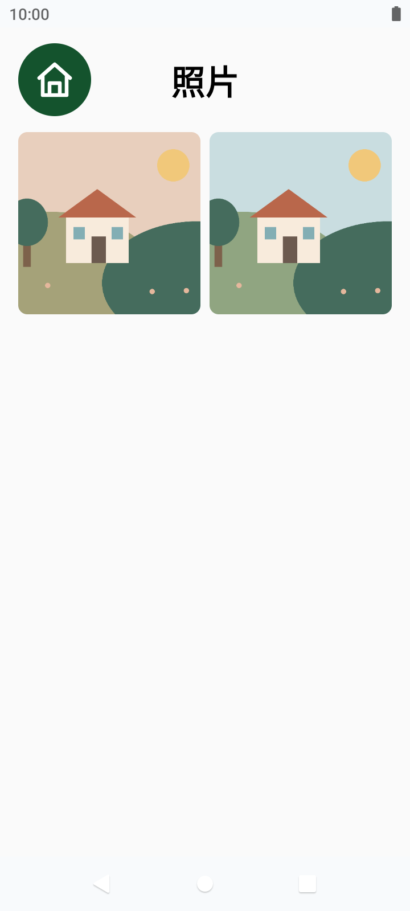
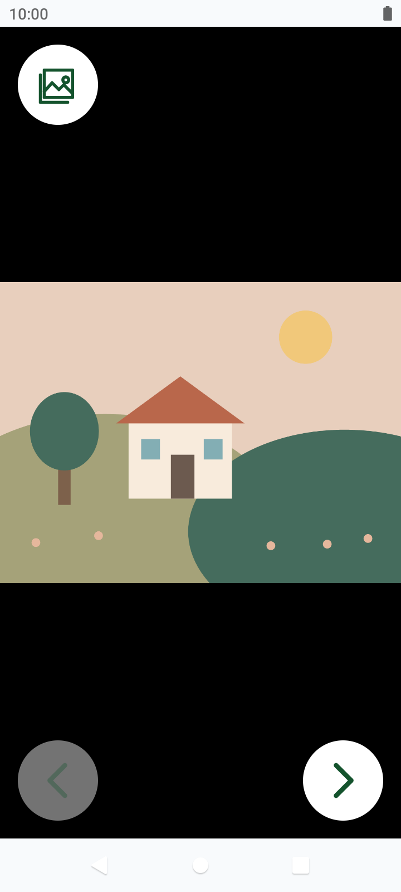

# EasyPhoto

**为家中长辈做的简洁 Android 相机与相册。**

拍照、看照片、回到首页。用更大的入口和清晰的图形操作，减少日常拍照的操作负担；维护设置交给家属。

A simple Android camera and gallery for older adults, built around large controls and a short everyday workflow.

[](https://github.com/KevinJiang05/EasyPhoto/actions/workflows/android.yml)
[](LICENSE)

[下载 APK](https://github.com/KevinJiang05/EasyPhoto/releases/latest) · [观看操作演示](https://github.com/KevinJiang05/EasyPhoto/releases/download/v0.3.0/EasyPhoto-demo.mp4) · [设计与技术案例](docs/showcase.md) · [构建与开发](docs/development.md)

## 看看实际操作



<table>
<tr>
<td align="center"><p>三个日常入口</p></td>
<td align="center"><p>直接拍照</p></td>
<td align="center"><p>两列大图相册</p></td>
<td align="center"><p>全屏看照片</p></td>
</tr>
</table>

以上为 App 在 Android 模拟器中的实际运行画面，照片为专门准备的非个人演示素材。它们用于展示交互，不代表真机画质或性能。[素材来源](docs/media/README.md)

## 为什么做

这个项目来自家庭长辈的实际拍照需求：希望常用功能容易找到，拍完后容易看到结果，遇到设置和维护时由家属处理。项目已在家庭场景中开始使用；目前没有开展正式用户研究，也不提供未经测量的成效数字。

## 保持简单的几件事

- **日常只保留三个入口**：后置拍摄、前置拍摄、看照片。
- **图形操作与可选反馈**：圆环快门、返回图标、闪光灯状态、翻页箭头，以及可关闭的震动和拍摄提示音。
- **照片先留在本机**：保存在 `Pictures/EasyPhoto/`，应用相册仅查询该目录；支持两列大图、全屏切换和缩放。
- **家属单独维护**：长按首页底部版本信息 4 秒，首次设置并确认 6 位数字 PIN；进入后可管理照片、调整显示和拍摄设置。
- **可选飞书照片通知**：默认关闭。开启后先保存照片，再异步上传至家属指定的群，通知失败不会阻塞拍照。

无广告、统计、账号注册或内购。飞书通知启用后会产生云端照片副本，具体见 [隐私与权限说明](docs/privacy-and-permissions.md)。

## 技术上解决了什么

采用 Kotlin、Jetpack Compose、CameraX、MediaStore 和 WorkManager，保持单模块结构。

- **相机资源有明确归属**：根据既有 Mate 20 问题定位，停用首页实时预览，避免首页与拍摄页争用 CameraX 导致卡死或返回闪退。
- **核心流程与通知分开**：MediaStore 保存成功后才入队，网络恢复后由 WorkManager 重试。
- **维护不进入老人日常流程**：管理员 PIN 在每台设备上设置，只保存随机盐与摘要；飞书凭据使用 Android Keystore 加密。

[查看完整案例](docs/showcase.md) · [架构说明](docs/architecture.md)

## 安装与验证状态

- Android 8.0 及以上，当前版本 `0.3.0`。
- 从 [Releases](https://github.com/KevinJiang05/EasyPhoto/releases/latest) 下载签名 APK，允许安装来源后安装；首次进入拍摄页时申请相机权限。
- 已有 Huawei Mate 20 上的历史真机验收记录；本轮展示使用模拟器，新 PIN 流程的真机复测仍待后续进行。
- 自动化测试、构建和 lint 的状态见上方 CI 与 [验收记录](docs/acceptance-record.md)。模拟器操作验证与历史真机结果分别记录。
- 不同机型的相机效果和默认桌面行为需要分别验证；夜景、HDR 等厂商原生相机能力不在保证范围内。

应用可作为默认桌面候选，提供可选的软锁定返回尝试；不具备企业 Kiosk 的强制锁机能力。

## 家属配置

首次长按首页底部版本信息设置 PIN，请妥善记住。忘记 PIN 需要清除应用数据重新配置，飞书等应用设置也会重置。维护完成后关闭管理员模式，再交给日常使用者。

飞书通知需要在管理员设置中填写自建应用凭据与群机器人 Webhook，并先测试连接。源码和 APK 不内置个人飞书配置。

## 开发与许可

使用 JDK 17/21、Android SDK Platform 36 和仓库 Gradle Wrapper。Windows 验证命令：

```powershell
.\gradlew.bat testDebugUnitTest assembleDebug lintDebug
```

[完整构建、安装和签名说明](docs/development.md) · [手动验收清单](docs/manual-test-checklist.md)

项目源码采用 [MIT License](LICENSE)，第三方依赖保留其各自许可证。开发者联系邮箱可在 App 首页查看；问题和建议也可提交到 [Issues](https://github.com/KevinJiang05/EasyPhoto/issues)。
