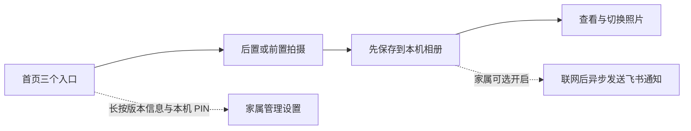

# EasyPhoto：让拍照回到简单的几步

EasyPhoto 从家庭长辈的拍照需求出发：把常用入口放大，把维护设置交给家属，让拍照和看照片保持直接。

项目已在家庭场景中开始使用，这是开发者提供的使用现状，不是正式用户研究或效果评估。本次展示不收集真实用户反馈，不使用家庭照片，也不声称已经证明普遍适用性。

## 使用流程

日常界面保留后置拍摄、前置拍摄和看照片三个入口。快门、返回、闪光灯和翻页使用图形按钮；照片可显示为两列大图。是否播放拍摄提示音、是否震动、是否允许缩放，由家属配置。首页仍包含文字提示，具体可用性取决于使用者，不能仅凭图形按钮称为完全不依赖识字。

## 三个值得说明的工程取舍

| 问题 | 实现与取舍 | 依据 |
| --- | --- | --- |
| 首页与拍摄页争用相机，可能出现卡死或返回闪退 | 拍摄页拥有 CameraX 资源；首页使用静态背景，停用不稳定的实时预览 | 既有 Mate 20 问题定位与验收记录 |
| 家属通知失败不应影响老人拍照 | MediaStore 保存成功后才加入 WorkManager 队列；联网后发送，失败退避重试 | `CameraScreen`、`FeishuPhotoScheduler`、`FeishuPhotoWorker` |
| 适老日常操作与维护操作需要不同复杂度 | 日常入口集中；长按版本信息后用家属设置的本机 PIN 进入管理，管理界面可批量删除和调整设置 | `HomeScreen`、`AdminScreen`、`EasyPhotoSettings` |

飞书通知默认关闭，启用后照片会上传到家属指定的群。凭据在设备上使用 Android Keystore 加密存储。照片首先保存到公共的 `Pictures/EasyPhoto/`，应用相册仅查询该目录。

## 实现范围

单模块原生 Android 项目，使用 Kotlin、Jetpack Compose、CameraX、MediaStore 和 WorkManager。产品边界、权限策略、相机生命周期处理、适老交互和交付验证是本作品的展示重点；通用相机、UI 和任务调度能力复用现有开源依赖。

应用可作为默认桌面候选，也提供可选的软锁定返回尝试；它不具备企业设备管理的强制锁机能力。夜景、HDR 等厂商原生相机效果不在保证范围内。

## 证据与边界

- [历史真机与自动化验收记录](acceptance-record.md)：包含 Mate 20 上已完成的人工验收与问题修复。本次新增流程的验证结果单独记录，不能由历史记录代替。
- [手动验收清单](manual-test-checklist.md)：供后续有真机时复测。
- [架构说明](architecture.md)、[隐私与权限](privacy-and-permissions.md)：说明实现与数据流。
- [展示素材说明](media/README.md)：区分模拟器画面、演示内容和真实使用证据。

当前不提供用户成效数字、适老认证或跨机型全面兼容结论。
